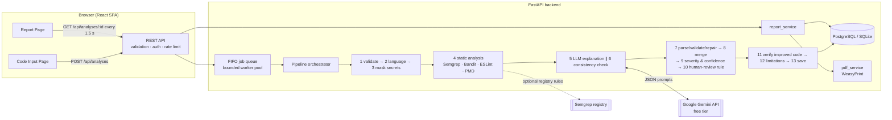

# Explainable AI Code Review Assistant

A website where a developer pastes source code (or uploads one file) and receives a **structured, transparent
explanation report**: what the code does, a section-by-section breakdown, every risk with *where*, *why*, *how to
fix*, *how serious* and *how confident*, an improved version with the reason for each change, and a
Transparency tab that states exactly what was and was not checked.

It combines **rule-based static analysis** (Semgrep, Bandit, ESLint + security plugin, PMD) with a **large
language model** (Google Gemini, free tier). The model must answer in a fixed JSON structure; the backend
validates it, merges AI and static findings, assigns severity and confidence with fixed rules, applies a
human-review rule, and stores the report. **Submitted code is never executed.**

Project: *Enhancing Explainability and Transparency in AI-Assisted Software Development* — Ayeni Opeyemi.

---

## Contents

1. [Architecture](#architecture) · 2. [Features (FR1–FR16)](#features) · 3. [Prerequisites](#prerequisites) ·
4. [Quick start with Docker](#quick-start-with-docker) · 5. [Local development](#local-development) ·
6. [Configuration](#configuration) · 7. [Gemini API key and model](#getting-a-free-gemini-api-key-and-choosing-the-model) ·
8. [Switching the LLM provider](#switching-the-llm-provider) · 9. [Tests](#running-the-tests) ·
10. [Benchmark](#benchmark) · 11. [User study](#user-study) · 12. [Deployment](#deployment) ·
13. [Security and privacy](#security-and-privacy) · 14. [Known limitations](#known-limitations) · 15. [Licence](#licence)

---

## Architecture



In production the FastAPI app also serves the built frontend from the same origin (cookies stay same-site).
In development, Vite runs on port 5173 and proxies `/api` to port 8000.

```
xai-code-review/
├── backend/        FastAPI app (app/), Alembic migrations, tests (pytest)
├── frontend/       React + TypeScript + Vite + Tailwind, Vitest unit tests, Playwright e2e tests
├── evaluation/     30-sample benchmark, ground truth, scoring scripts, user-study materials
├── docs/           DECISIONS.md, API.md, TEST_CASES.md
├── Dockerfile      single production image (backend + built frontend + tools)
└── docker-compose.yml
```

## Features

| ID | Feature | Where |
|---|---|---|
| FR1 | Paste code into a code editor or upload one `.py/.js/.mjs/.cjs/.java` file (drag and drop works too) | `CodeEditor`, `FileUploadButton`, `POST /api/analyses` |
| FR2 | Choose the language or auto-detect it | `LanguageSelect`, `pipeline/language.py` |
| FR3 | Reject empty, too long (400 lines by default), binary or unsupported input with clear messages | `pipeline/validation.py`, live line counter |
| FR4 | Mask passwords/keys/tokens before anything is sent to the LLM | `pipeline/redaction.py` |
| FR5 | Run Semgrep + Bandit (Python), Semgrep + ESLint (JavaScript), Semgrep + PMD (Java) | `static_analysis/` |
| FR6 | Plain-language purpose summary | Overview tab |
| FR7 | Section-by-section breakdown with line ranges | Breakdown tab |
| FR8 | Risks with lines, why it matters, how to fix, severity, confidence, CWE and OWASP | Risks tab |
| FR9 | Improved code side by side with the original, each change with its reason | Improved Code tab |
| FR10 | Overall risk, overall confidence, limitations and a human-review recommendation | Overview + Transparency |
| FR11 | Source of every finding: static analysis, AI, or both | `SourceBadge`, `pipeline/merge.py` |
| FR12 | Download the full report as a PDF | `GET /api/analyses/{id}/pdf` |
| FR13 | Rate each explanation and comment | `FeedbackWidget` |
| FR14 | Register, log in, log out | `/api/auth/*` |
| FR15 | Registered users reopen and delete past analyses | History page |
| FR16 | Admin: manage users, usage statistics (incl. Gemini quota), analysis settings | `/admin/*` |

## Prerequisites

* **Docker** (Docker Desktop on Windows/macOS) — simplest way; everything else is inside the image.
* For local development without Docker: **Python 3.12+**, **Node.js 20+**, optionally **Java 17** (for PMD).
  Semgrep and WeasyPrint's PDF libraries are Linux-friendly; on Windows they are optional (see below).

## Quick start with Docker

```bash
cp .env.example .env          # Windows PowerShell: Copy-Item .env.example .env
# edit .env: set LLM_PROVIDER=mock to try it offline, or add your GEMINI_API_KEY (see below)
docker compose up --build
```

Open **http://localhost:8000**. Log in as the administrator with `ADMIN_EMAIL` / `ADMIN_PASSWORD` from `.env`
(change them!). Check `http://localhost:8000/api/health`: `"llm": "ok"` and all tools `true`.

The compose file runs PostgreSQL 16 and the app. Migrations run automatically at start-up.

## Local development

```bash
# Backend
cd backend
python -m venv .venv
.venv/bin/pip install -e ".[dev]"              # Windows: .venv\Scripts\pip install -e ".[dev]"
.venv/bin/pip install -e ".[tools]"            # Semgrep (Linux/macOS only)
.venv/bin/uvicorn app.main:app --reload         # http://localhost:8000 (runs migrations automatically)

# ESLint runner (for JavaScript analysis)
cd backend/app/static_analysis/eslint && npm install

# PMD (optional, Java analysis): download PMD 7 from https://github.com/pmd/pmd/releases,
# unzip it and set PMD_BIN in .env (Windows: ...\pmd-bin-7.x.y\bin\pmd.bat). Without it, PMD is "unavailable".

# Frontend
cd frontend
npm install
npm run dev                                      # http://localhost:5173 (proxies /api to :8000)
```

`make dev` starts both (Linux/macOS). On Windows use **`tasks.ps1`** — it has the same targets:
`.\tasks.ps1 dev`, `.\tasks.ps1 test`, `.\tasks.ps1 lint`, `.\tasks.ps1 benchmark-dry`, ….

## Configuration

All settings come from environment variables (`.env`); see `.env.example` for every variable with comments.

| Variable | Default | Meaning |
|---|---|---|
| `APP_ENV` | `development` | `production` enforces a strong `JWT_SECRET`, `COOKIE_SECURE=true` and an API key |
| `APP_BASE_URL` | `http://localhost:5173` | public URL (CSRF origin check in production) |
| `DATABASE_URL` | `sqlite:///./data/app.db` | PostgreSQL in Docker: `postgresql+psycopg://xai:xai@db:5432/xai` |
| `JWT_SECRET`, `JWT_EXPIRE_MINUTES` | — / 720 | session token signing |
| `COOKIE_SECURE` | `false` | `true` behind HTTPS |
| `ADMIN_EMAIL`, `ADMIN_PASSWORD`, `ADMIN_NAME` | | administrator created at first start |
| `LLM_PROVIDER` | `gemini` | `gemini` · `mock` · `openai` · `anthropic` |
| `LLM_MODEL` | `gemini-flash-latest` | free-tier Flash model ID |
| `GEMINI_API_KEY` | empty | from Google AI Studio |
| `LLM_TEMPERATURE`, `LLM_MAX_OUTPUT_TOKENS` | 0.2 / 8192 | |
| `GEMINI_REQUESTS_PER_MINUTE`, `GEMINI_REQUESTS_PER_DAY` | 4 / 18 | keep below your key's free-tier limits |
| `GEMINI_THINKING` | `low` | `off` · `low` · `default` |
| `LLM_MAX_CONCURRENT_JOBS` | 2 | analyses processed at the same time; others queue |
| `LLM_TIMEOUT_SECONDS`, `LLM_MAX_RETRIES` | 90 / 2 | |
| `PROMPT_VERSION` | `v1` | prompt templates in `backend/app/llm/prompts/v1/` |
| `SEMGREP_USE_REGISTRY` | `true` | also use public Semgrep packs (needs internet) |
| `STATIC_TOOL_TIMEOUT_SECONDS` | 30 | |
| `ESLINT_DIR`, `PMD_BIN` | `/opt/eslint`, `/opt/pmd/bin/pmd` | tool locations (Docker paths; dev falls back automatically for ESLint) |
| `DEFAULT_*` | | first values of the admin-editable settings (stored in the database afterwards) |

Admin-editable at runtime (Admin → Analysis settings, applied within 30 s): maximum lines/characters, guest
retention hours, rate limits, consistency check on/off, enabled tools per language, LLM temperature.

## Getting a free Gemini API key and choosing the model

1. Go to **Google AI Studio** (<https://aistudio.google.com>) and sign in with a Google account.
2. Click **Get API key → Create API key**. No credit card is needed for the free tier.
3. Copy the key into `.env` as `GEMINI_API_KEY=...` (never commit `.env`, never paste the key into code or chat).
4. In AI Studio, open the **rate limits** page for your key and note, for the Flash model you will use, the
   requests per minute (RPM), requests per day (RPD) and tokens per minute (TPM). Free-tier limits change, so
   always read them there.
5. Set:
   * `LLM_PROVIDER=gemini`
   * `LLM_MODEL=gemini-flash-latest`, or the exact Flash model ID AI Studio shows as free for your key (no
     "lite", "image", "tts" or "live" variants; Pro models are not free).
   * `GEMINI_REQUESTS_PER_MINUTE` ≈ 70% of your RPM (e.g. RPM 10 → 7).
   * `GEMINI_REQUESTS_PER_DAY` ≈ 90% of your RPD.
6. Start the app and open `/api/health`. It should show `"llm": "ok"`. If it shows `model_not_found`, change
   `LLM_MODEL`; if `not_configured`, check the key. Every report records the **resolved model name** in its
   Transparency tab.
7. Capacity: each analysis uses 2 requests (1 if the consistency check is off), so with RPM 10 about 3–5
   analyses per minute complete; extra users wait in the queue (shown on the progress page).
8. **Privacy:** on the free tier Google may use your prompts and responses to improve its products. Only use
   test code and the benchmark samples; tell study participants not to paste their own confidential code. The
   website says this in its privacy notice and in every report.
9. With a paid plan nothing in the code changes: raise the `GEMINI_*` limits in `.env`.

When the AI cannot be used (no key, wrong model, daily quota used up, service busy, blocked answer) the report
still completes with the static-analysis findings and a yellow banner explaining why.

## Switching the LLM provider

Only `.env` changes — no code changes (all providers implement one interface, `backend/app/llm/client.py`):

| Provider | Settings |
|---|---|
| Google Gemini (chosen) | `LLM_PROVIDER=gemini`, `GEMINI_API_KEY`, `LLM_MODEL` |
| Offline mock (demos, tests) | `LLM_PROVIDER=mock` — deterministic, no network; reports say "Mock explanation" |
| OpenAI (optional) | `pip install -e ".[openai]"`, `LLM_PROVIDER=openai`, `OPENAI_API_KEY`, `LLM_MODEL` |
| Anthropic (optional) | `pip install -e ".[anthropic]"`, `LLM_PROVIDER=anthropic`, `ANTHROPIC_API_KEY`, `LLM_MODEL` |

## Running the tests

| What | Command |
|---|---|
| Everything required (lint + backend + frontend unit) | `make test` · Windows: `.\tasks.ps1 test` |
| Backend unit + integration | `cd backend && .venv/bin/pytest` |
| Tests that run the real tools (Semgrep rules, Bandit, ESLint, PMD) | `make test-all` or `pytest -m tools` (best inside Docker) |
| Frontend unit (Vitest) | `cd frontend && npm test` |
| End-to-end (Playwright) against Docker | `make e2e` (needs `LLM_PROVIDER=mock` in `.env`; `npx playwright install` once) |
| All 30 samples in the browser | `cd frontend && npx playwright test all-samples --project=chromium-desktop` |
| Performance (NFR1, real Gemini) | `make perf` |
| Live Gemini smoke test | `RUN_LIVE_TESTS=1 GEMINI_API_KEY_LIVE=... pytest -m live_gemini` |

Inside Docker: `docker compose exec app python -m pytest -m tools` is not available (tests are not copied into
the image); run the tool tests with `docker run --rm -v "$PWD/backend:/src" -w /src xai-code-review:latest
sh -c "pip install -q pytest && python -m pytest -m tools"`.

Tests never call the real Gemini API (they use the mock provider and a fake Gemini SDK client).

## Benchmark

See [`evaluation/README.md`](evaluation/README.md). In short:

```bash
python evaluation/scripts/check_ground_truth.py
LLM_PROVIDER=mock python evaluation/scripts/run_benchmark.py --conditions system baseline --runs 2 --out evaluation/results/dry-run
python evaluation/scripts/run_benchmark.py --conditions system baseline --runs 2 --out evaluation/results/final   # real, Gemini
python evaluation/scripts/export_for_labelling.py --results evaluation/results/final   # reviewers fill labelling.csv
python evaluation/scripts/score_benchmark.py --results evaluation/results/final         # metrics.md for Chapter Four
```

The real run needs at least 180 Gemini requests; if the daily quota runs out, rerun with `--resume` the next day.

## User study

Materials in `evaluation/user_study/` (consent form, counterbalanced tasks, explanation questionnaire, SUS,
facilitator script, response template). Score with:

```bash
python evaluation/scripts/score_user_study.py --responses evaluation/user_study/responses.csv --out evaluation/results/user_study
```

## Deployment

The image is a single container that serves the API and the website. Example: **Render**.

1. Push the repository to GitHub (`.env` is git-ignored — never commit it).
2. On Render create a **PostgreSQL** database (any plan) and copy its *internal* connection string; change the
   prefix `postgres://` / `postgresql://` to `postgresql+psycopg://`.
3. Create a **Web Service** → *Build and deploy from a Git repository* → select the repository →
   Runtime **Docker** (it uses the root `Dockerfile`). **One instance only** (the job queue and the Gemini
   pacer live in the process).
4. Environment variables (Settings → Environment):
   `APP_ENV=production`, `COOKIE_SECURE=true`, `APP_BASE_URL=https://<your-service>.onrender.com`,
   `DATABASE_URL=<step 2>`, `JWT_SECRET=<long random string>`, `ADMIN_EMAIL`, `ADMIN_PASSWORD`,
   `LLM_PROVIDER=gemini`, `LLM_MODEL`, `GEMINI_API_KEY`, `GEMINI_REQUESTS_PER_MINUTE`, `GEMINI_REQUESTS_PER_DAY`.
   Render sets `PORT`; the container listens on it.
5. Deploy. Health check path: `/api/health`. Render provides HTTPS; HTTP is redirected to HTTPS by the app.
6. **Logs:** Render dashboard → the service → *Logs* (JSON lines: `event`, `public_id`, `stage`, `duration_ms`,
   …). Submitted code and prompts are never logged in production.
7. **Roll back:** Render → *Events* → choose an earlier successful deploy → *Rollback*. Database migrations are
   additive; if a rollback crosses a migration, run `alembic downgrade <revision>` from a shell first.

Railway or Fly.io work the same way (Dockerfile deploy + managed PostgreSQL + the same variables).

## Security and privacy

* **Code is never executed** — only parsed or analysed as text. A test scans the backend for `eval`, `exec`,
  `os.system` and `shell=True`; tools run with argument lists, timeouts and resource limits.
* **Secrets are masked** before code goes to the LLM (11 patterns), including inside tool messages.
* Passwords hashed with **bcrypt** (cost 12). Sessions are **HS256 JWTs** in an `httpOnly`, `SameSite=Lax`,
  `Secure` (production) cookie. Deactivated or deleted users' tokens are rejected.
* **CSRF:** state-changing requests must be JSON; in production the `Origin`/`Referer` must match the site.
* Security headers: strict **CSP** (Monaco is bundled locally, no CDN), `nosniff`, `frame-ancestors 'none'`,
  HSTS in production. Rate limits: analyses per hour (guests per IP, users per account), 10 logins per 15 min.
* **Privacy:** guest reports are deleted after 24 h (job every 15 min); registered users choose whether their
  code is stored; reports owned by a user are visible only to that user and admins (others get 404).
* User code and AI text are always rendered as **plain text** (never HTML) in the website and escaped in the PDF.
* The Gemini free tier may use submitted code to improve Google's products — stated in the privacy notice,
  the About page and every report.

## Known limitations

* Code is analysed as text only; runtime behaviour, other files and dependencies are not checked.
* Single files only; Python, JavaScript and Java only.
* AI explanations can be wrong; confidence levels come from fixed rules (tool agreement, consistency), not from
  the model's own probability.
* The free Gemini tier limits throughput (queueing) and daily volume; when the quota is used up, reports are
  static-only until midnight Pacific time.
* On Windows without Docker, Semgrep (no Windows build) and PDF export (needs Pango) are unavailable; the app
  reports this clearly. Use Docker for the full feature set.
* The mock provider is a demonstration aid; its "AI" findings are simple pattern rules.

See [`docs/DECISIONS.md`](docs/DECISIONS.md) for every interpretation of the specification.

## Licence

MIT licence — © 2026 Ayeni Opeyemi. Third-party tools keep their own licences (Semgrep LGPL-2.1, Bandit
Apache-2.0, ESLint MIT, PMD BSD-style, Monaco MIT).
